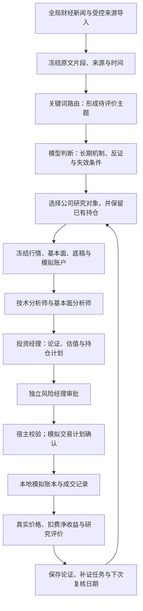

# 新闻驱动的长期投资模拟 Agent

一个用新闻发现投资线索、用公司证据检验长期逻辑、再用模拟持仓和真实价格检验判断的研究项目。当前重点是 **A股**；美股与旧版实验代码保留，美股新增工作暂停。

它关注的不只是“今天该不该买”，还包括：**什么行业可能更有前景、哪些公司可能受益、依据是否可靠、什么价格满足建仓条件，以及持有后到底赚亏多少。** 所有交易只写入本地模拟账本，没有券商或真实资金接口。

> 默认分支 [`main`](https://github.com/Y0usheng/a-stock-agent/tree/main) 提供当前长期投资模拟版本。完整改动与验证记录见 [PR #1](https://github.com/Y0usheng/a-stock-agent/pull/1)。

## 整个系统怎样运作



### 1. 新闻先发现主题，再寻找公司

新闻MCP从东方财富全球财经快讯读取最近200条，并支持受控来源的文章导入。关键词只把新闻归入算力、电动车、医药、金融、资源等主题，不负责判断利好程度。

随后，一次模型判断区分结构变化、周期变化、短期噪声和风险，说明“这件事可能怎样影响收入或现金流”，给出反方观点、待核验项和失效条件。媒体转述、公司披露与模型推断分别标记。

当前主题映射覆盖12家受控A股公司，新收盘后流程每轮最多新增2个研究对象；公司清单、仓位及交易参数在 [config.py](config.py)。公司与主题的关系仍待核验；池外行业显示覆盖缺口。新闻热度、转载数量或一个合作标题，都不能单独证明长期投资价值。

### 2. 公司研究使用四个角色

| 角色 | 工作 |
|---|---|
| 技术分析师 | 查看真实价格、均线、成交量及历史走势 |
| 基本面分析师 | 核对业务、财务、行业资料及来源时点 |
| 投资经理 | 汇总论证，提出估值、目标仓位、建仓和退出条件 |
| 风险经理 | 独立审核逐股计划，批准、缩量或拒绝 |

默认模型配置为 `gpt-6.1-sol`，通过官方 `codex exec` 调用本机ChatGPT订阅登录；模型能否使用取决于账户、额度和客户端版本。两位分析师是独立分支，订阅请求按角色串行发送并共用预算。

所有角色只读，不能直接下单。程序验证证据、价格、仓位和真实审批；经理自行写一句“风控通过”不会获得执行权限。

### 3. 长期投资不等于每天重选股票

默认协议采用三年投资论证、252交易日阶段观察、最长90天复核。三年是研究框架，不是保证持有三年；方向预测也不是每日交易开关。

| 状态 | 含义 |
|---|---|
| 待补核心资料 | 业务、财务或估值依据不足；列具体补证任务，7天内复核 |
| 等待价格 | 研究依据和估值可用，等待建仓条件 |
| 计划建仓 | 提出目标仓位与交易计划，继续接受风控及宿主检查 |
| 继续持有 | 既有论证延续，按期限及新事件复核 |
| 减仓或退出 | 论证失效、估值或风险触发退出条件 |

已有模拟持仓会保留。没有合格新主题时延续已有研究；没有已有研究则跳过。没有当天新闻不会自动清空论证，补证任务的首次期限也不会每天顺延。

### 4. 判断能追溯到哪些资料

新闻保存事件ID、链接、发布时间、首次采集时间、原文片段与内容哈希。只保存event_id无法保证供应商日后仍返回当时的内容，所以本地保留绑定片段；修订生成新身份，不覆盖旧版本。某行情日只能使用截止时已经采集的资料，不能把后来新闻回填成历史知识。

公司底稿保存披露时间、报告期和页码/段落。结论引用冻结证据ID，宿主检查内容、股票范围及时间是否可用；主题引用还需提供可见片段中的连续原句。

默认流程自动从巨潮官方索引下载每家最新完整年报及之后最新中期报告（季报或半年报），原件只保存本机。PDF、提取文本及相关页码片段各自绑定哈希；跨页财务表保留上一页的表头与单位，同页其他表的单位不能代用。扫描件、单位缺失、无法绑定股票代码或超时会明确留缺口，每轮补证预算90秒、零模型调用。

这些检查能确认引用存在，不能单独证明推断正确。项目另有事实/观点/推断拆分、抽样语义复核和原句定位。自动提取不等于逐页审核，也未获得独立人工标注的语义准确率。

### 5. 模拟成交与真实收益

`--shadow` 只分析。默认 `manager-long-v2` 将行情日期、实际信息截止、决策完成与未来执行时点分别保存。17:30研究可使用截止前已观察到的盘后消息；本轮不能按当天已知收盘价补买。

正式模拟出现买卖计划时，须在执行交易日14:55之前于本机确认完整计划哈希。执行日由真实交易日历选择；该日收盘后，用其真实不复权收盘价、既有滑点和费用记入模拟账本。成交价相对冻结参考价设2%不利偏离上限；超时、超限、报价缺失或账户变化会到期、取消或暂停，不能临时改价补成交。这是预先确认的收盘价模拟，日成交量约束使用事后数据，不声称复制实际收盘集合竞价。

A股账本当前配置为100万元初始模拟现金、一手100股、T+1、单股最高30%仓位，并计入佣金、卖出印花税、滑点和成交量参与率限制。这些是项目模拟参数，不是完整交易所规则的实现。

成交使用唯一订单身份，重复提交不会重复扣款。组合收益来自实际模拟成交及真实价格估值，成交价已含滑点，统计时不再重复扣除。空仓零亏损不能直接证明策略有效。

### 6. 用实验检验判断

项目分别评价预测方向、论证与证据的关系、实际模拟组合收益和风险。研究工具支持预先登记假设、基线和成功标准，冻结输入，区分训练/验证/测试，同成本重放，并保留失败与无数据结果。

旧版5日实验和新252日观察保持各自口径。真实历史价格搭配合成新闻的工程实验，会明确标记，不能当成真实历史新闻策略表现。

## 页面能看到什么

已加入[GitHub Pages与CI发布链路](docs/PAGES_AND_CI.md)：本机运行并公开筛选后的报告，网页按日期查看；main经过PR、测试及保护规则更新。订阅登录与原始账本继续保留本机。

**[在线查看每日记录](https://y0usheng.github.io/a-stock-agent/)**，可选择日期并分享对应报告链接。

本地入口为 `http://127.0.0.1:5000/trading`：

- 新闻主题、原文片段、模型假设、反证及公司入选/未选理由。
- 真实收盘价、MA20/MA60、成交量和实际模拟买卖标记。
- 现金、持仓、成交费用、浮盈亏与扣费后的组合净收益。
- 新协议的信息截止、决策完成、未来执行日期和计划状态；公开页面不能批准交易。
- 入选后股票的独立价格观察；从严格晚于入选日的首个已收盘价格开始，至少两个后续价格才能计算涨跌。

入选后的价格观察未计交易费用，也没有模拟成交，单独展示。过去股票涨跌不会补造为Agent历史收益。页面及 `/api/trading-view`、`/api/opportunities` 只读本地数据，刷新不会调用模型或交易；股价缓存需显式更新。

## 本地运行

当前以Windows、PowerShell和Python 3.12验证。先安装官方Codex CLI，使终端能够找到其可执行文件，按[官方认证说明](https://developers.openai.com/codex/auth)登录。

```powershell
git clone https://github.com/Y0usheng/a-stock-agent.git
cd a-stock-agent
python -m venv .venv
.venv\Scripts\python -m pip install -r requirements.txt

# 登录由官方客户端完成，不向项目复制令牌
codex login
.venv\Scripts\python agent/run_daily.py --preflight

# 完全离线规则演示：不调用模型、不提交模拟订单
.venv\Scripts\python agent/run_daily.py --mock --offline --shadow

# 实时订阅分析：默认A股、长期协议，只分析
.venv\Scripts\python agent/run_daily.py --shadow

# 启动只读仪表盘，打开本地 /trading
.venv\Scripts\python dashboard/app.py
```

按需单独执行：

```powershell
# 只采集与路由，零模型调用
.venv\Scripts\python scripts/discover_opportunities.py --refresh --rules-only
# 对存档新闻做一次主题判断，不触发公司四角色或下单
.venv\Scripts\python scripts/discover_opportunities.py
# 导入已核对的公司披露片段，查看补证任务
.venv\Scripts\python scripts/company_research.py import-material material.json
.venv\Scripts\python scripts/company_research.py tasks
# 更新真实股价及HTML；首次可用--symbols指定研究对象
.venv\Scripts\python scripts/refresh_trading_view.py --provider sina
# 导出某日公开报告并触发GitHub Pages部署
.venv\Scripts\python scripts/publish_reports.py export --date 2026-10-29
.venv\Scripts\python scripts/publish_reports.py publish
# 正式模拟入口：计划须按输出的完整哈希确认
.venv\Scripts\python agent/run_daily.py --market cn
# 本地研究闭环演示与回归
.venv\Scripts\python scripts/research.py demo
.venv\Scripts\python -m unittest discover -s tests -v
```

实时数据不可用时不冒充真实行情。新闻发现失败会记录错误，可延续可用的旧存档和既有研究；缺少当天新闻不一概否决已有长期论证。显式API/SDK对照、固定研究池及计划确认命令见专题文档。

## 订阅、凭据与调用成本

**仓库不需要也不应包含任何人的订阅令牌。** 项目只调用本机官方客户端，先查询登录方式，再提交受约束的研究输入；不实现令牌提取、复制或上传。官方客户端将登录凭据存放在本机文件或系统凭据库中，`auth.json` 应像密码一样保管。见[官方凭据存储说明](https://developers.openai.com/codex/auth#login-caching)。

订阅子进程剔除API密钥环境变量，关闭工具、联网搜索及其他Agent能力。临时输入/输出放在被Git忽略的 `data/` 中并尝试清理；原始认证错误不会直接写入项目日志。公开新闻和必要的虚拟账本数据会发送给模型服务完成分析。

| 阶段 | 默认限制 |
|---|---|
| 新主题判断 | 最多1次请求，75秒，12,000 tokens检查阈值 |
| 公司四角色 | 最多4次请求，共40,000 tokens，每次120秒 |
| 页面、本地规则与评分 | 不调用模型 |

令牌阈值是调用前/完成后检查，不是精确截断生成；超限结果拒用，实际用量仍保留。相同发现输入可复用缓存。语义模型复核是额外的显式调用。订阅有额度限制；API对照须显式启用并按对应API用量计费，订阅失败不会静默切换。

`.env.example` 只是示例清单，项目不自动加载；设置来自进程环境变量。Git忽略规则排除环境文件、登录缓存、私钥、数据库和原始日志。上传前检查暂存内容及本地可达历史：

```powershell
python scripts/check_repository_secrets.py --history
```

检查只输出文件名、规则和位置，不输出匹配内容，也不读取本机登录目录。模式扫描不能保证发现任意形式的秘密；发现泄漏须撤销/轮换凭据，删除当前文件不能清除历史曝光。

本仓库已开启GitHub密钥扫描和推送保护，协助发现并阻止受支持格式的凭据进入仓库；本地检查同时覆盖登录缓存文件名与运行数据路径。

## 代码与进一步说明

| 位置 | 职责 |
|---|---|
| `agent/run_daily.py`、`agent/graph_runner.py` | 日循环、冻结截面、编排、确认及执行校验 |
| `agent/opportunities.py`、`agent/investment.py` | 主题、长期论证、底稿与补证任务 |
| `agent/subscription.py`、`agent/evidence.py` | 订阅调用、预算和冻结证据 |
| `servers/` | 行情、新闻及模拟账户MCP服务 |
| `evals/` | 语义复核、收益风险、实验与重放 |
| `dashboard/`、`scripts/`、`tests/` | 页面、操作入口与回归测试 |

[新闻发现](docs/NEWS_OPPORTUNITIES.md) · [长期协议](docs/LONG_TERM_INVESTING.md) · [交易曲线](docs/TRADING_VIEW.md) · [模型接入](docs/MODEL_ACCESS.md) · [证据追溯](docs/EVIDENCE_TRACEABILITY.md) · [语义复核](docs/SEMANTIC_REVIEW_PLAN.md) · [实验闭环](docs/RESEARCH_LOOP.md) · [项目状态](docs/PROJECT_STATUS.md)

## 当前边界

数据和12家公司映射仅部分覆盖市场；公告原件下载与页码片段绑定已自动化，财务表语义、估值假设及披露真伪仍须复核，没有独立标注的语义准确率。长期组合尚未积累足够的向前持仓记录，主题判断和流程测试不代表投资有效。

收盘后协议、成交恢复与原文绑定的验证和操作见 [收盘后研究与未来模拟成交](docs/AFTER_CLOSE_EXECUTION.md)。历史实验、网页报告和新协议各保留自身时间口径，后续以对应提交的测试结果和实际向前记录为准。

本项目用于研究与模拟，不构成投资建议。
